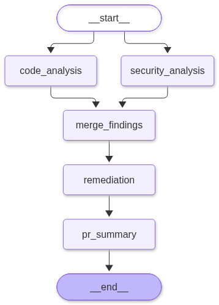

# 🛡️ CRSA-Agent: AI Code Review & Security Analysis Platform

[](https://www.python.org/)
[](https://www.langchain.com/langgraph)
[](https://www.langchain.com/)
[](https://streamlit.io/)
[](https://www.pinecone.io/)
[](https://ai.google.dev/)
[](https://groq.com/)
[](LICENSE)

An enterprise-grade, autonomous **Multi-Agent Code Review & Security Analysis Platform** built with **LangGraph**, **LangChain**, and **Streamlit**. **CRSA-Agent** automates static syntax verification, quality anti-pattern detection, OWASP/CWE security scanning, actionable code remediation, pull request summary generation, and interactive RAG-powered developer advisory.

---

## 📑 Table of Contents

- [Overview & Problem Statement](#-overview--problem-statement)
- [Key Features](#-key-features)
- [Multi-Agent Architecture](#-multi-agent-architecture)
  - [Workflow Graph](#workflow-graph)
  - [Agent Breakdown](#agent-breakdown)
  - [RAG Architecture (CCA)](#rag-architecture-conversational-code-assistant)
- [Project Structure](#-project-structure)
- [Tech Stack](#-tech-stack)
- [Installation & Setup](#-installation--setup)
  - [Prerequisites](#prerequisites)
  - [Installation Steps](#installation-steps)
  - [Environment Configuration](#environment-configuration)
- [Knowledge Base Ingestion (RAG)](#-knowledge-base-ingestion-rag)
- [Usage Guide](#-usage-guide)
  - [Launching the Web Application](#1-launching-the-web-application)
  - [Running the Headless Pipeline](#2-running-the-headless-pipeline)
  - [Reviewing Findings & Remediation](#3-reviewing-findings--remediation)
  - [Exporting Audit Reports (PDF)](#4-exporting-audit-reports-pdf)
  - [Consulting the Conversational Code Assistant](#5-consulting-the-conversational-code-assistant-cca)
- [Test Benchmarking Dataset](#-test-benchmarking-dataset)
- [Contributing](#-contributing)
- [License & Author](#-license--author)

---

## 🎯 Overview & Problem Statement

Modern software engineering teams face significant bottlenecks in maintaining clean, robust, and secure codebases:
- **Inconsistent Quality & Code Smells:** Subjective manual reviews fail to consistently catch maintainability debt, architectural degradation, and high cyclomatic complexity.
- **Undetected Security Vulnerabilities:** Critical flaws (e.g., OWASP Top 10 vulnerabilities like SQL Injection, Hardcoded Secrets, Insecure Deserialization, SSRF, Broken Access Control) often slip through into production.
- **Review Fatigue & Developer Delays:** Engineering teams spend hours on repetitive pull request reviews without offering immediate, educational, and actionable remediation steps.

**CRSA-Agent** solves this by orchestrating specialized AI agents in a structured, parallel execution graph. The system detects syntax errors before execution, isolates code quality issues and security vulnerabilities in parallel, unifies findings by severity, produces drop-in refactored code fixes, generates executive PR decisions, and provides an integrated RAG assistant grounded in real-world application security standards.

---

## ✨ Key Features

- **🚀 AST & Compiler Pre-Validation:**
  - Zero-latency syntax validation using Python's `ast.parse` and Java's `javac` (with fallback delimiter/bracket checks).
  - Pinpoints exact error line, character offset, and contextual remediation hints before consuming LLM tokens.
- **⚡ Parallel Multi-Agent Orchestration (LangGraph):**
  - **Code Analysis Agent** and **Security Vulnerability Agent** execute concurrently over the AST-validated code.
  - Merges and normalizes findings into a unified, severity-sorted ledger (`CRITICAL` > `HIGH` > `MEDIUM` > `LOW` > `INFORMATIONAL`).
- **🛡️ Comprehensive Security Auditing (OWASP / CWE):**
  - Audits for SQL injection, Command injection, Cross-Site Scripting (XSS), Hardcoded API keys and secrets, Broken Access Controls, Path Traversal, and Cryptographic weaknesses.
- **💡 Automated Code Remediation Engine:**
  - Produces contextual, drop-in replacement code snippets preserving existing logic while eliminating vulnerabilities and design anti-patterns.
- **📝 Automated PR Summary & Merge Gatekeeper:**
  - Computes severity distributions, prioritizes urgent fixes, and delivers automated merge verdicts: `APPROVED`, `APPROVED_WITH_SUGGESTIONS`, or `CHANGES_REQUESTED`.
- **🧠 Conversational Code Assistant (RAG - CCA):**
  - Grounded in an indexed vector knowledge base of OWASP Top 10 (2021 & 2025), OWASP Cheat Sheets, and Java/Python secure coding standards.
  - Answers follow-up queries with source citations and contextual awareness of current audit findings.
- **📊 Executive PDF Audit Reports:**
  - One-click exportable, publication-ready PDF reports built with ReportLab, featuring severity distribution charts, finding logs, and complete remediation blueprints.
- **🎨 Modern Developer Portal:**
  - Streamlit-powered UI with dark/purple design system, interactive Plotly metrics, code diff viewers, and preloaded benchmark presets.

---

## 🏗️ Multi-Agent Architecture

### Workflow Graph

The core analysis pipeline is built as a stateful computational graph using **LangGraph**. The workflow executes the initial static agents concurrently, unifies and sorts their outputs, synthesizes fixes, and produces the final pull request recommendation:

### Agent Breakdown

| Agent | Engine / Model | Primary Role |
| :--- | :--- | :--- |
| **Code Analysis Agent** | Groq (`qwen/qwen3.8-27b`) | Evaluates cyclomatic complexity, code smells, duplication, documentation quality, and maintainability anti-patterns. |
| **Security Analysis Agent** | Groq (`qwen/qwen3.8-27b`) | Scans for OWASP Top 10 vulnerabilities, CWE weaknesses, credential leaks, and insecure data flows. |
| **Remediation Agent** | Groq (`qwen/qwen3.8-27b`) | Generates compliant, drop-in corrected code snippets with best practice explanations for every identified finding. |
| **PR Summary Agent** | Groq (`qwen/qwen3.8-27b`) | Aggregates all findings into a structured PR review verdict (`APPROVED`, `APPROVED_WITH_SUGGESTIONS`, `CHANGES_REQUESTED`), severity breakdown, and prioritized remediation roadmap. |
| **Conversational Code Assistant (CCA)** | Google Gemini (`gemini-2.5-flash`) + Pinecone | Context-aware, RAG-grounded conversational agent for interactive Q&A regarding audit findings, secure coding guidelines, and refactoring queries. |


## 📁 Project Structure

```text
CRSA-Agent/
├── .env                              # Environment variable configurations
├── .gitignore                        # Git exclusion rules
├── .python-version                   # Defined Python runtime version (3.11)
├── graph.png                         # Exported LangGraph execution visualization
├── LICENSE                           # MIT License
├── problem-statement.md              # Requirements and project specifications
├── pyproject.toml                    # UV / PEP 621 dependency specifications
├── README.md                         # Detailed project documentation
├── uv.lock                           # UV deterministic dependency lockfile
│
├── Agile project tracking/           # Project management artifacts
│   ├── Agile_Template_v0.1.xls       # Agile sprint tracking template
│   ├── Defect_Tracker Template_v0.1.xlsx # Bug & defect tracking sheet
│   └── Unit_Test_Plan_v0.1.xlsx      # Test execution plans
│
├── src/
│   ├── crsa_agent/                   # Core agent package
│   │   ├── __init__.py               # Package initializer
│   │   ├── graph.py                  # LangGraph StateGraph orchestration definition
│   │   ├── initial_code_check_utils.py # AST parser & javac compiler validation
│   │   ├── state.py                  # Pydantic schemas & MessageState definitions
│   │   └── agent/                    # Individual agent chain & node implementations
│   │       ├── cca.py                # Conversational Code Assistant chain
│   │       ├── code_analysis/        # Code quality analysis chain & node
│   │       ├── security_analysis/    # OWASP vulnerability analysis chain & node
│   │       ├── remediation/          # Remediation & refactoring chain & node
│   │       └── pr_summary/           # PR review summary chain & node
│   │
│   ├── log/                          # Structured logging subsystem
│   │   ├── __init__.py
│   │   └── logger.py                 # Colored console & status logger
│   │
│   ├── rag/                          # Retrieval-Augmented Generation subsystem
│   │   ├── data_ingestion.py         # Markdown corpus loader, splitter & Pinecone indexer
│   │   ├── run_rag.py                # Standalone RAG execution & retrieval tests
│   │   ├── trail_notebook.ipynb      # RAG exploration & experimentation notebook
│   │   └── data_sources/             # Security knowledge base corpus
│   │       ├── 01_OWSAP_top10/       # OWASP Top 10 standards (2021 & 2025)
│   │       ├── 02_owasp/             # Official OWASP Cheat Sheet Series
│   │       ├── 03_java/              # Java secure coding standards
│   │       ├── 04_python/            # Python secure coding practices
│   │       └── 05_best_practises/    # SOLID principles, clean code & design patterns
│   │
│   ├── test/                         # Comprehensive evaluation testbed
│   │   ├── README.md                 # Test suite documentation
│   │   ├── manifest.csv              # Test catalog with expected defect taxonomy
│   │   └── files/                    # 40 curated benchmark files (20 Python, 20 Java)
│   │
│   └── ui/                           # Streamlit Web Application
│       ├── app.py                    # Multi-page application entry point & navigation
│       ├── notes.md                  # UI architecture notes
│       ├── pages/
│       │   ├── input_page.py         # Code submission, presets & AST validation page
│       │   └── result_page.py        # Security audit dashboard & reporting page
│       └── components/               # Modular UI widgets
│           ├── analysis_service.py   # Interface to LangGraph execution engine
│           ├── assistant.py          # Conversational assistant UI panel
│           ├── header.py             # Global application header
│           ├── helpers.py            # Formatting & parsing utility helpers
│           ├── input_panel.py        # Code editor & benchmark preset selector
│           ├── results_panel.py      # Severity metrics, findings, remediation & PDF generator
│           ├── session.py            # Streamlit session state management
│           ├── styles.py             # Custom CSS styling (Purple Theme)
│           └── validation.py         # Real-time pre-analysis validation dispatcher
```

---

## 🛠️ Tech Stack

- **Orchestration & Workflow:** [LangGraph](https://github.com/langchain-ai/langgraph), [LangChain](https://github.com/langchain-ai/langchain)
- **Large Language Models:** [Groq](https://groq.com/) (`qwen/qwen3.8-27b`), [Google Gemini](https://ai.google.dev/) (`gemini-2.5-flash`)
- **Vector Database & Embeddings:** [Pinecone](https://www.pinecone.io/), [HuggingFace](https://huggingface.co/) (`sentence-transformers/all-MiniLM-L6-v2`)
- **Web Interface:** [Streamlit](https://streamlit.io/), [Plotly](https://plotly.com/), HTML5/CSS3
- **PDF Generation & Visuals:** [ReportLab](https://www.reportlab.com/), [Matplotlib](https://matplotlib.org/)
- **Static Analysis & Parsing:** Python built-in `ast`, Java `javac`, regular expressions
- **Package & Runtime Management:** [uv](https://github.com/astral-sh/uv), Python 3.11+

---

## 🚀 Installation & Setup

### Prerequisites

1. **Python 3.11+** installed on your system.
2. **uv** (recommended for ultra-fast dependency resolution) or standard `pip`.
3. **Java compiler** or  **JDK (Java Development Kit)** with `javac` available in your system `PATH` if you wish to run compiler-level Java syntax pre-checks.

### Installation Steps

1. **Clone the repository:**
   ```bash
   git clone https://github.com/your-username/CRSA-Agent.git
   cd CRSA-Agent
   ```

2. **Set up a virtual environment:**
   Using `uv`:
   ```bash
   uv venv
   # On Windows:
   .venv\Scripts\activate
   # On Linux/macOS:
   source .venv/bin/activate
   ```

   

3. **Install dependencies:**
   Using `uv`:
   ```bash
   uv pip install -e .
   ```
   

### Environment Configuration

Create a `.env` file in the project root by copying the template below:

```env
# =========================================================
# LLM Providers
# =========================================================
GROQ_API_KEY="your_groq_api_key_here"
GOOGLE_API_KEY="your_google_gemini_api_key_here"

# =========================================================
# Vector Database (Pinecone)
# =========================================================
PINECONE_API_KEY="your_pinecone_api_key_here"
PINECONE_INDEX_NAME="crsa-knowledge-base"

# =========================================================
# LangChain Tracing & Observability (Optional)
# =========================================================
LANGCHAIN_TRACING_V2="true"
LANGCHAIN_API_KEY="your_langchain_api_key_here"
LANGCHAIN_PROJECT="CRSA-Agent"
```

> **API Key Requirements:**
> - **Groq:** Powers fast structured inference for Code Analysis, Security Analysis, Remediation, and PR Summary. Obtain a key at [console.groq.com](https://console.groq.com/).
> - **Google Gemini:** Powers the Conversational Code Assistant (CCA). Obtain a key at [aistudio.google.com](https://aistudio.google.com/).
> - **Pinecone:** Stores and indexes the security knowledge base. Obtain a key and create a serverless index at [pinecone.io](https://www.pinecone.io/) (Dimension: `384`, Metric: `cosine`).

---

## 📚 Knowledge Base Ingestion (RAG)

To enable the **Conversational Code Assistant (CCA)**, index the provided security corpus (OWASP Top 10, cheat sheets, Python/Java security standards) into Pinecone:

1. Ensure your `.env` contains valid `PINECONE_API_KEY`, `PINECONE_INDEX_NAME`, and `GOOGLE_API_KEY`.
2. Execute the ingestion script:
   ```bash
   python src/rag/data_ingestion.py
   ```
3. The script will:
   - Recursively parse all `.md` files in `src/rag/data_sources/`.
   - Chunk content with `RecursiveCharacterTextSplitter` (chunk size: 1000, overlap: 150).
   - Generate embeddings using `sentence-transformers/all-MiniLM-L6-v2`.
   - Upsert vectors with deduplication hashes directly to your Pinecone index.

---

## 💻 Usage Guide

### 1. Launching the Web Application

Start the Streamlit portal:

```bash
streamlit run src/ui/app.py
```

The application will launch at `http://localhost:8501`.

### 2. Running the Headless Pipeline

You can invoke the LangGraph agent mesh programmatically or via CLI without starting the UI:

```bash
python src/crsa_agent/graph.py
```

This will run the sample audit defined in `graph.py` and output `graph.png` showing the graph structure.

### 3. Reviewing Findings & Remediation

1. Navigate to the **Code Scanner & Presets** page (`/`).
2. Choose one of the built-in benchmark presets (e.g., *Hardcoded Secret (Python)* or *SQL Injection (Java)*) or paste your own code.
3. Click **Start Code Analysis**.
4. The system validates syntax; upon passing, the multi-agent mesh evaluates the code.
5. On the **Security Audit Dashboard** (`/result`), view:
   - **PR Review Status** card (`APPROVED`, `APPROVED_WITH_SUGGESTIONS`, `CHANGES_REQUESTED`).
   - **Severity Breakdown** metrics and interactive distribution charts.
   - **Unified Findings Ledger** with severity badges, affected line numbers, and impact descriptions.
   - **Remediation Panel** displaying side-by-side corrected code snippets and best practice explanations.

### 4. Exporting Audit Reports (PDF)

On the results dashboard:
1. Click **Export Audit Report (PDF)**.
2. A formal document is generated using ReportLab containing:
   - Audit metadata and timestamp.
   - Embedded severity distribution chart.
   - Consolidated PR overview and prioritized fixes.
   - Tabular breakdown of all security and quality findings.
   - Full code remediation blocks and best practices.

### 5. Consulting the Conversational Code Assistant (CCA)

In the dashboard drawer:
1. Select one of the auto-suggested questions or type your custom query.
2. The assistant retrieves relevant chunks from the Pinecone vector index and answers using Gemini 2.5 Flash, providing source-backed explanations tailored to the analyzed code.

---

## 🧪 Test Benchmarking Dataset

The repository includes a benchmark suite of **40 code samples** located in `src/test/files/` and indexed in `src/test/manifest.csv`:

| Test Category | Python Files | Java Files | Description |
| :--- | :---: | :---: | :--- |
| **Clean Baseline** | 2 | 2 | Compliant code used as negative-control benchmarks. |
| **Syntax Errors** | 4 | 4 | Syntax and compilation errors to test pre-validation robustness. |
| **Code Quality Only** | 4 | 4 | Code smells, dead code, high complexity, and poor naming. |
| **Security Only** | 4 | 4 | Isolated OWASP vulnerabilities (SQLi, hardcoded tokens, XSS). |
| **Mixed (Quality + Security)** | 6 | 6 | Real-world dirty code containing overlapping quality and security flaws. |
| **Total** | **20** | **20** | **40 Comprehensive Benchmark Testbeds** |

---

## 🤝 Contributing

Contributions are welcome! Please follow these steps:

1. Fork the repository.
2. Create a feature branch: `git checkout -b feature/your-feature-name`.
3. Commit your changes: `git commit -m "feat: add your feature description"`.
4. Push to the branch: `git push origin feature/your-feature-name`.
5. Open a Pull Request.

Please ensure code conforms to PEP 8 standards and passes formatting checks (`black`, `isort`).

---

## 📄 License & Author

Distributed under the **MIT License**. See [LICENSE](LICENSE) for details.

- **Author:** Venkata Viswas Tumbali
- **Email:** [tumbalivenkataviswas@gmail.com](mailto:tumbalivenkataviswas@gmail.com)
- **Repository:** [CRSA-Agent](https://github.com/tumbalivenkataviswas/CRSA-Agent)
